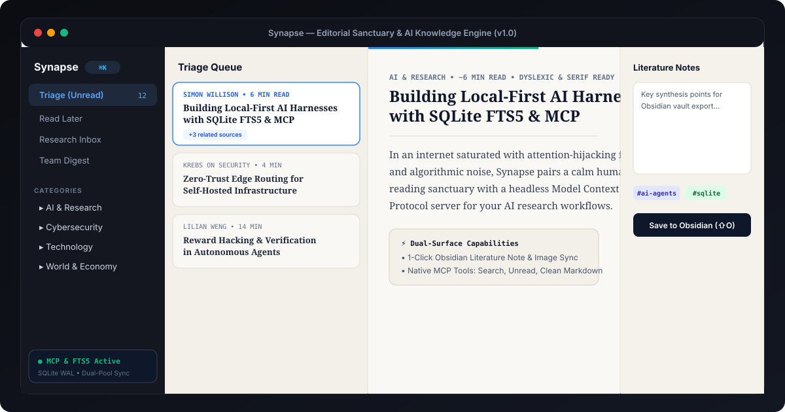

# Synapse — Private, AI-Native RSS++ Reader & Knowledge Engine

[](./LICENSE)
[](./package.json)
[](https://github.com/Haribu/synapse/actions)
[](https://github.com/Haribu/synapse/pkgs/container/synapse)
[](./scripts/mcp-server.ts)
[](./AGENTS.md)



Synapse is a self-hosted, privacy-first **Dual-Surface Knowledge Platform**:

1. **The Human Surface:** A calm, distraction-free reading sanctuary featuring warm paper palettes, self-hosted OpenDyslexic typography, dwell attention tracking, and tactile keyboard navigation.
2. **The Agent Surface:** A headless, high-throughput ingestion daemon, full-text FTS5 search engine, and clean Markdown extraction pipeline accessible to local AI assistants via **Model Context Protocol (MCP)** and REST APIs.

---

## ⚡ 1-Minute Quickstart

Run Synapse with zero build steps directly from the GitHub Container Registry, or clone the repository:

### Option A: Prebuilt Docker Image (Instant)

```bash
docker run -d \
  --name synapse \
  -p 3000:3000 \
  -v synapse_data:/app/data \
  ghcr.io/haribu/synapse:latest

open http://localhost:3000
```

### Option B: Clone & Compose

```bash
# 1. Clone the repository
git clone https://github.com/Haribu/synapse.git
cd synapse

# 2. Launch with Docker Compose
docker compose up -d --wait

# 3. Open Synapse in your browser
open http://localhost:3000
```

When you first launch Synapse, the interactive onboarding wizard guides you through:

1. **Curated Starter Packs:** 1-click subscriptions across Tech & Engineering, AI & Research, Cybersecurity & CTI, World & Economy, and Design & Culture.
2. **Import OPML:** Instant migration from Feedly, Inoreader, Miniflux, or NetNewsWire.
3. **Manual Entry:** Add any RSS/Atom feed or web URL with automatic feed discovery.

---

## 🌟 The Dual-Surface Architecture

### Surface 1: The Human Reading Sanctuary

- **3-Tier Adaptive Responsive Breakpoints:**
  - **Phone (`<768px`):** Single-pane reading focus with auto-hiding top/bottom bars on scroll and touch swipe triage (swipe right to Read, swipe left to Star).
  - **Tablet (`768px–1279px`):** Balanced 2-pane split (`ItemList` + `ReaderView`) with a slide-over feed drawer so reading space is never compressed.
  - **Desktop (`≥1280px`):** Full 3-pane layout with pointer-draggable splitters and a docked inline Notes Drawer (`xl:w-80`).
- **Warm Paper & Deep Obsidian Ink:** Low-glare palettes engineered for sustained reading comfort.
- **Self-Hosted OpenDyslexic Typography:** Served locally (`@font-face`) with real-time controls for font sizing, line height, letter spacing, and column width.
- **Active Dwell Attention Telemetry:** Accurately measures digested words against your reading speed (WPM) with page-visibility and 60-second inactivity watchdogs.
- **Knowledge Synthesis:** 1-click note export with YAML frontmatter directly into a mounted `/obsidian-vault`, or automatic fallback to browser `.md` downloads.

---

### Surface 2: The Agentic Knowledge Engine (Headless API & MCP)

Synapse is architected as an active research tool for local and frontier AI models.

#### 1. Native Model Context Protocol (MCP) Server

Synapse includes a bundled, zero-dependency MCP server (`bun run mcp`) exposing your reading library directly to **Claude Desktop**, **Antigravity**, **Cursor**, or **Claude Code**:

```json
// claude_desktop_config.json or antigravity.json
{
  "mcpServers": {
    "synapse": {
      "command": "bun",
      "args": ["run", "mcp"],
      "env": {
        "SYNAPSE_URL": "http://localhost:3000",
        "SYNAPSE_API_KEY": "optional-preshared-key"
      }
    }
  }
}
```

**Available MCP Tools:**

- `synapse_search(query, category?, limit?)`: Instant lexical FTS5 search across all articles.
- `synapse_get_unread(category?, limit?)`: Grabs your active reading queue.
- `synapse_get_markdown(id)`: Returns clean, token-efficient Markdown with YAML frontmatter.
- `synapse_triage(id, action)`: Programmatically marks read/unread, stars for later, or flags for team digest.
- `synapse_list_feeds()`: Live subscription audit with unread counts.

#### 2. Headless REST API

Every frontend action is backed by an atomic REST endpoint returning clean JSON. See [API.md](./API.md) for full documentation, parameter references, and copy-paste examples in `Python`, `TypeScript`, and `curl`.

#### 3. Dual-Pool Background Ingestion Engine

- **Worker Segregation:** Isolates fast RSS feeds (pool: 8 workers) from rate-limited YouTube feeds (pool: 2 workers).
- **Adaptive Intervals:** Standard feeds poll every 25 minutes; YouTube feeds poll every 2 hours, reducing background polling overhead by 75%.
- **Event-Loop Yielding:** Workers yield via `setImmediate` between items so API endpoints and health checks never stall.

---

## 🛠️ Configuration & Environment Variables

Copy `.env.example` to `.env` to customize your instance:

| Variable                    | Default        | Description                                                              |
| :-------------------------- | :------------- | :----------------------------------------------------------------------- |
| `HOST_PORT`                 | `3000`         | Port on host mapped to Synapse container (e.g. `127.0.0.1:3005`)         |
| `SYNAPSE_DATA_DIR`          | `/app/data`    | Database directory inside the container                                  |
| `SYNAPSE_BACKUP_DIR`        | `/app/backups` | Automatic snapshot backups directory                                     |
| `SYNAPSE_API_KEY`           | _empty_        | Pre-shared Bearer token for AI agents & MCP servers to bypass proxy auth |
| `OBSIDIAN_VAULT_PATH`       | _empty_        | Mount path to Obsidian vault (e.g. `/obsidian-vault`)                    |
| `AUTH_MODE`                 | `none`         | Authentication mode: `none`, `cloudflare`, or `header`                   |
| `ALLOWED_EMAILS`            | _empty_        | Whitelist of user emails for Cloudflare Access                           |
| `GOOGLE_OAUTH_ACCESS_TOKEN` | _empty_        | Optional Google Docs & Drive export token                                |

### Customizing with `docker-compose.override.yml`

For local directory mounts or custom network setups, copy `docker-compose.override.yml.example` to `docker-compose.override.yml`:

```yaml
# docker-compose.override.yml (gitignored)
services:
  synapse:
    environment:
      - OBSIDIAN_VAULT_PATH=/obsidian-vault
    volumes:
      - "/Users/username/Documents/Obsidian:/obsidian-vault"
```

---

## 💾 Database Safety & Integrity Protocol

Synapse stores its primary database on a native Linux named volume (`synapse_data:/app/data`), preventing VirtioFS file-lock corruption bugs on macOS/Windows Docker setups.

- **Atomic Snapshot Backups:** Run `bun run db:backup` or trigger `POST /api/admin/backup` to execute a zero-lock SQLite `VACUUM INTO` snapshot to `./backups`.
- **Integrity Checks:** Run `bun run db:check` or verify in Settings > Storage to execute `PRAGMA integrity_check` safely via the container API.
- **Zero Host-Level Writes While Container is Running:** Never execute direct host-level SQLite writes (`sqlite3 ./data/synapse.db`) while the Docker container is active.

---

## 🤝 Contributing & Developer Scripts

```bash
bun dev              # Start local Next.js development server
bun test             # Run unit and integration tests
bun x tsc --noEmit   # Validate static TypeScript typing
bun run bump [rc|patch|minor|major] # Automated SemVer bumper
bun run mcp          # Start local Model Context Protocol server
bun run db:backup    # Trigger atomic database snapshot
bun run db:check     # Run database integrity check
```

Review [CONTRIBUTING.md](./CONTRIBUTING.md) for pull request guidelines.

---

## 🤖 For AI Agents & Autonomous Collaborators

If you are an AI coding agent (Claude Code, Antigravity, Cursor, Devin, Codex) executing work on this codebase:

1. **Read [AGENTS.md](./AGENTS.md) first:** It codifies the architecture, sandbox rules, database integrity anti-corruption constraints, and verification protocols.
2. **Strict Database Lock Protection:** NEVER run `sqlite3` directly against `./data/synapse.db` from the host while the Docker container is active. Use `bun run db:check` or `bun run db:backup` via the container API.
3. **Always Run Idempotent Tests:** Validate any changes with `bun test && bun x tsc --noEmit`.

---

## 📄 License

This project is licensed under the [MIT License](./LICENSE).
